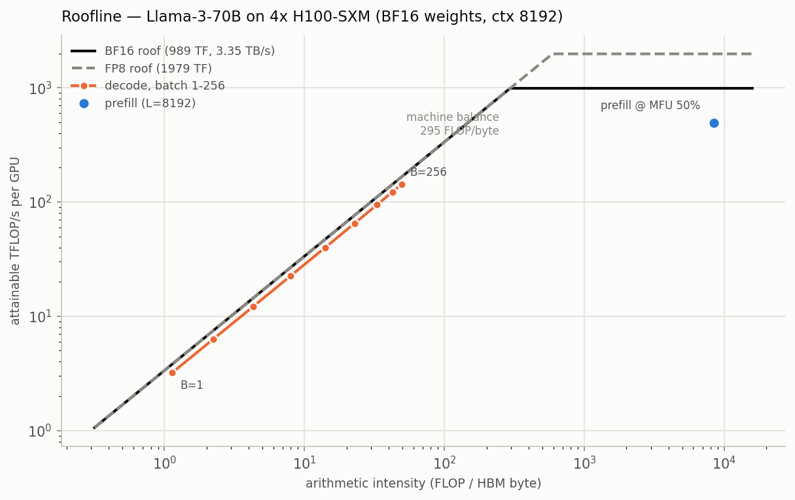
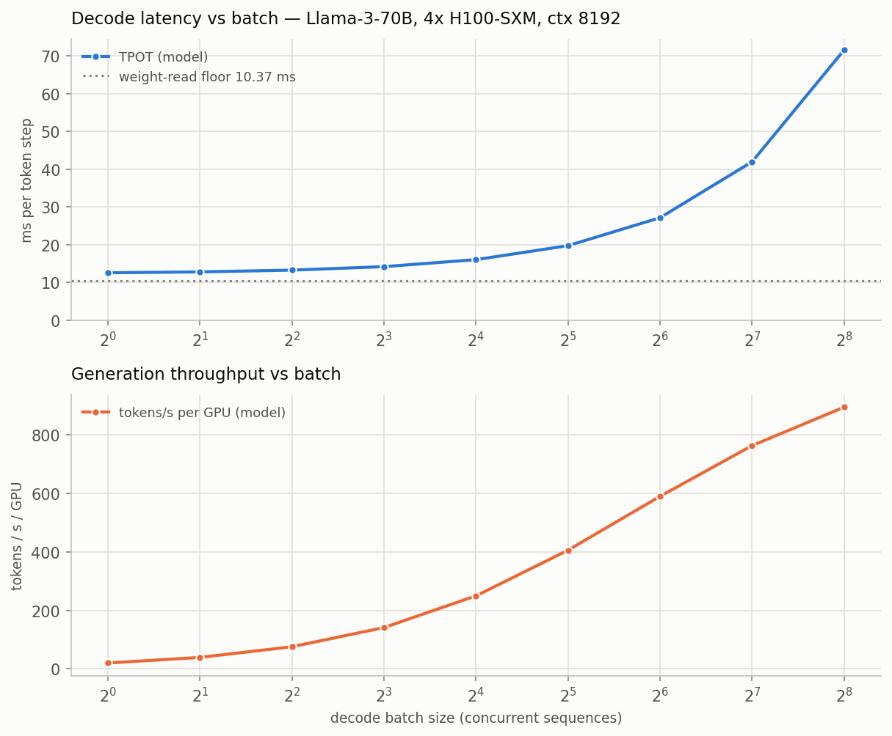
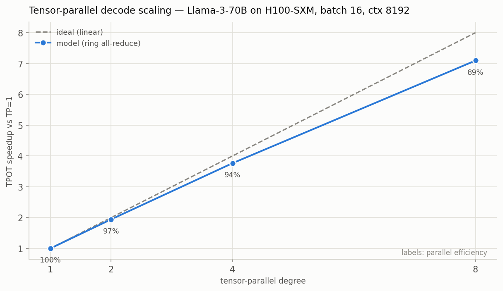

# llm-roofline

**A first-principles analytical performance model of LLM inference on NVIDIA
datacenter GPUs.** Thesis: *you can predict most of LLM inference performance
with a napkin, if the napkin is rigorous* — and this repo quantifies exactly
when and why the napkin breaks.

From hardware specs (dense TFLOPS, HBM bandwidth, NVLink) and model
architecture (GQA/MLA attention, dense/MoE MLPs), it predicts prefill and
decode latency (TTFT/TPOT), throughput vs batch, KV-cache capacity limits,
tensor-parallel scaling, energy per token, and cost per million tokens — and
draws the rooflines that explain every one of those numbers. Pure Python +
numpy + matplotlib; no GPU required to run it.

## Why

- **Capacity planning before hardware.** "How many H200s to serve 70B at 8k
  context and 100 concurrent users?" is answerable on paper, to first order,
  and the paper answer is the sanity check every benchmark should face.
- **Systems intuition, made computable.** The roofline model
  (Williams, Waterman & Patterson, CACM 2009) reduces performance to
  arithmetic intensity vs machine balance. LLM inference is an unusually clean
  roofline subject: prefill lives far right of the knee (compute-bound), decode
  far left of it (memory-bound), and almost every serving technique — batching,
  FP8, GQA, MLA, tensor parallelism — is a move on this one chart.
- **The analytical complement to inference-systems engineering.** Serving
  stacks like NVIDIA Dynamo, TensorRT-LLM, vLLM, and FlashInfer engineer
  against exactly these bounds (disaggregated prefill/decode is roofline
  reasoning turned into an architecture). This tool computes the bounds those
  systems chase.

## The napkin, worked

*How fast **can** Llama-3-70B decode on 4×H100-SXM (BF16, batch 1, ctx 8192)?*

Decode is memory-bound: every generated token must stream the weights through
HBM once.

```
TPOT >= weight_bytes / (TP x HBM_bw)
      = 139 GB / (4 x 3.35 TB/s) = 10.4 ms/token        <- inviolable floor
```

Add 90% achievable bandwidth, the KV read at 8k context (320 KiB/token/seq),
and 2 ring all-reduces per layer over NVLink, and the model says:

```
$ python -m llm_roofline report --model llama-3-70b --gpu h100 --tp 4 --batch 1..256 --context 8192

TPOT = 12.56 ms  ->  80 tok/s single-stream   (bound: memory)
TTFT (8k prompt) = 684 ms  (1,209 TFLOP at MFU 50%)
KV budget: 147 GB free -> 448k tokens -> 54 concurrent 8k sequences
```

No measured H100 system will meaningfully beat 80 tok/s single-stream on this
config, because 10.4 ms of it is physics. Batching climbs the roofline:
20 → 895 tok/s/GPU from batch 1 → 256, at 35 → 0.8 J/token — and the tool
tells you the KV cache caps you at 54 concurrent 8k sequences before you get
there, which is why the H200 exists.

## The three plots (`./run.sh report`)



**Roofline.** Decode (orange, batch 1→256) crawls up the bandwidth-slanted
part of the roof: at batch 1 it runs at ~3 TFLOP/s — 0.3% of the H100's peak —
not because kernels are bad but because arithmetic intensity is ~1 FLOP/byte.
Prefill (blue) sits at ~8,400 FLOP/byte, far right of the 295 FLOP/byte machine
balance: compute-bound, plotted at its assumed 50% MFU. At ctx 8192 with BF16
KV, batch 256 still hasn't reached the knee — KV reads grow the memory traffic
as fast as batch grows the FLOPs, so this configuration *never* goes
compute-bound (the closed-form critical batch diverges).



**TPOT and throughput vs batch.** TPOT stays within ~1.3× of the weight-read
floor (dotted) until batch ~32, then KV traffic takes over. Throughput rises
sub-linearly for the same reason: batch 256 buys 45× the tokens of batch 1 for
5.7× the latency.



**TP scaling.** Memory-bound decode shards weights, so TP genuinely cuts
per-token latency — 94% parallel efficiency at TP4, 89% at TP8 under an
*idealized* ring all-reduce (5 µs/op + NVLink volume). Real NCCL on real
schedulers does worse; this curve is the upper bound.

## Validation (the honesty centerpiece)

Full details, URLs, and caveats in [VALIDATION.md](VALIDATION.md). Three tiers:

1. **Exact** — parameter counts derived from architecture algebra match
   published totals: Llama-3-8B/70B, Llama-2-70B, Mistral-7B to <0.01%;
   Qwen2.5-32B +0.8%; Mixtral-8x7B 46.703B/12.88B active; DeepSeek-V3
   **671.03B derived vs 671B published** (+1.5% on 37B active). Automated in
   `tests/test_params.py`.
2. **Anchored** — prediction vs published measured throughput
   (`python -m llm_roofline validate`):

   | Measured benchmark | Measured tok/s | Predicted | Error |
   |---|---|---|---|
   | [Llama-3.3-70B FP8, 2×H100, 128/128 (TRT-LLM)](https://nvidia.github.io/TensorRT-LLM/performance/perf-overview.html) | 6,092 | 6,584 | +8% |
   | [Llama-3.3-70B FP8, 2×H200, 2048/2048 (TRT-LLM)](https://nvidia.github.io/TensorRT-LLM/performance/perf-overview.html) | 3,776 | 5,786 | +53% |
   | [Llama-3.1-8B FP8, 1×H100, 128/128 (TRT-LLM)](https://nvidia.github.io/TensorRT-LLM/performance/perf-overview.html) | 26,401 | 33,990 | +29% |
   | [Llama-3.1-8B FP8, 1×H100, 2048/128 (TRT-LLM)](https://nvidia.github.io/TensorRT-LLM/performance/perf-overview.html) | 3,276 | 3,498 | +7% |
   | [Llama-2-70B FP8, MLPerf v4.1 offline, per H200](https://developer.nvidia.com/blog/nvidia-blackwell-platform-sets-new-llm-inference-records-in-mlperf-inference-v4-1) | 4,358 | 3,443 | −21% |

   Right shape, right bounds, tens of percent absolute error — and the largest
   errors land exactly where the model's own assumptions (flat MFU, no
   scheduler, ideal continuous batching) are weakest. That diagnosis is in
   VALIDATION.md, not hidden.
3. **Sanity** — no prediction may ever beat `weight_bytes / raw_HBM_bw`; a
   test sweeps every model × GPU × dtype × TP × batch (including MFU=1.0,
   HBM efficiency=1.0) and asserts the floor holds.

## Limitations — read before trusting a number

- **MFU is an assumed input (default 0.5), not a prediction.** This model does
  not know about kernel shapes, wave quantization, or attention-kernel
  efficiency. Everything compute-bound scales linearly in your MFU guess.
- **No kernel-level effects**: no FlashAttention specifics, no CUDA graph or
  launch overheads, no chunked-prefill interference, no speculative decoding,
  no paged-KV fragmentation beyond a flat 10% reserve.
- **Communication is an idealized ring all-reduce** with a single latency
  constant. No NCCL protocol switching, no overlap with compute, no
  SHARP/NVLS in-switch reduction. TP curves are upper bounds.
- **Steady-state throughput only**: the benchmark predictor conserves work but
  ignores schedulers, SLO-constrained batching, and P/D disaggregation.
- **MoE routing is modeled as worst-case-uniform** (expert coverage
  `min(E, B·k)`), not learned-routing skew; expert-parallel and data-parallel
  layouts are out of scope (TP only).
- Fitted simulators (e.g. [Vidur, MLSys 2024](https://arxiv.org/abs/2405.05465))
  and actual profilers predict real deployments far better. This tool is the
  *analytical complement*: it tells you what is physically on the table before
  you profile, and whether a benchmark number is near a bound or nowhere close.
  **It does not replace profiling.**

## Quickstart

```bash
# no install needed beyond numpy + matplotlib
./run.sh demo                      # guided walkthrough of the headline claims
./run.sh test                      # 73 tests: params, KV, floors, crossovers, TP, CLI
./run.sh report                    # default: llama-3-70b on 4x h100, plots to results/

# anything else:
python -m llm_roofline report --model deepseek-v3 --gpu h200 --tp 8 \
    --batch 1..256 --context 8192 --dtype fp8 --cost-per-gpu-hr 3.50
python -m llm_roofline validate    # prediction vs published measurements
python -m llm_roofline list        # supported models and GPUs
```

Python API:

```python
from llm_roofline import get_model, get_gpu, decode, Assumptions

d = decode(get_model("llama-3-70b"), get_gpu("h100"), batch=32, context=8192,
           tp=4, a=Assumptions(weight_dtype="fp8", kv_dtype="fp8"))
print(d.tpot_s, d.bound, d.tok_per_s_per_gpu, d.energy_per_tok_j)
```

## Supported hardware and models

GPUs (dense TFLOPS, verified against vendor documents cited in `gpus.py`):
A100-SXM-80GB, H100-SXM, H200-SXM, B200, L40S, RTX 4090. Marketing numbers are
2:4-sparsity-doubled; this database stores **dense** rates only.

Models (from public HF configs cited in `models.py`): Llama-3-8B, Llama-3-70B,
Llama-2-70B, Mistral-7B, Qwen2.5-32B, Mixtral-8x7B (MoE), DeepSeek-V3
(MoE + MLA, with the compressed-latent KV formula from the papers).

## References

- Williams, Waterman, Patterson — *Roofline: An Insightful Visual Performance
  Model for Multicore Architectures*, CACM 52(4), 2009.
  https://doi.org/10.1145/1498765.1498785
- Pope et al. — *Efficiently Scaling Transformer Inference*, arXiv:2211.05102.
- DeepSeek-AI — *DeepSeek-V2* (MLA), arXiv:2405.04434; *DeepSeek-V3 Technical
  Report*, arXiv:2412.19437.
- Agrawal et al. — *Vidur: A Large-Scale Simulation Framework for LLM
  Inference*, arXiv:2405.05465 (what to use when this napkin isn't enough).
- NVIDIA TensorRT-LLM performance overview:
  https://nvidia.github.io/TensorRT-LLM/performance/perf-overview.html
- NVIDIA MLPerf Inference v4.1 results blog:
  https://developer.nvidia.com/blog/nvidia-blackwell-platform-sets-new-llm-inference-records-in-mlperf-inference-v4-1
- NVIDIA Dynamo (disaggregated serving — roofline reasoning as architecture):
  https://github.com/ai-dynamo/dynamo
- kipply — *Transformer Inference Arithmetic*:
  https://kipp.ly/transformer-inference-arithmetic/ (the napkin tradition this
  repo formalizes and validates).

MIT © 2026 Azra Bano

## See also

- [disagg-sim](https://github.com/azrabano23/disagg-sim) — the systems side: a discrete-event simulator scheduling against exactly these rooflines (disaggregation, KV-aware routing)
- [warpfield](https://github.com/azrabano23/warpfield) — differentiable PDE optimization on NVIDIA Warp (CPU-verified, CUDA-ready)
